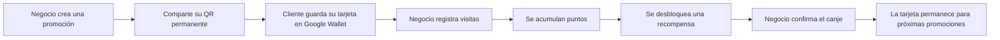
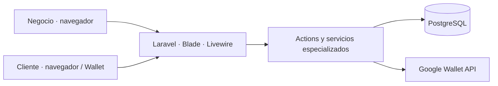
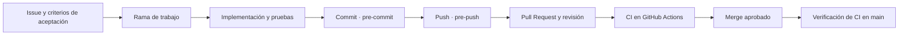

# FidelitoPass

**Promociones que hacen volver a tus clientes.**

**FidelitoPass** es una aplicación web de fidelización para pequeños negocios. Permite crear promociones por tiempo limitado, premiar las visitas recurrentes y entregar una tarjeta digital que el cliente conserva en **Google Wallet**. La mecánica es simple: **visitar el negocio, sumar puntos y obtener una recompensa**.

El producto se desarrolla como un **MVP funcional** con un ciclo de fidelización completo. El alcance está acotado y tanto las reglas de negocio como los controles técnicos quedan preparados para siguientes versiones.

## El problema y la propuesta

Muchos negocios de atención directa quieren incentivar el regreso de sus clientes sin incorporar un CRM complejo, sin pedirles que instalen una aplicación adicional y sin gestionar tarjetas físicas. Además, un programa de puntos pierde atractivo cuando el cliente no entiende cómo participa, cuánto le falta o cuándo vence su recompensa.

FidelitoPass propone una experiencia sencilla para ambos lados:

1. **El negocio** configura una promoción, comparte un código QR permanente, registra las visitas y confirma los canjes.
2. **El cliente** accede sin registrarse en FidelitoPass, guarda la tarjeta en Google Wallet y la presenta cuando vuelve. La misma tarjeta le sirve para futuras promociones del negocio.

El objetivo del MVP es **validar la viabilidad funcional y técnica del ciclo de fidelización**, desde la incorporación del cliente hasta el canje. La validación comercial requiere pilotos y mediciones posteriores, el presente MVP todavía no es una conclusión del producto como tal.

## Cómo funciona



Una visita normal suma **1 punto**. Para incentivar determinados días u horarios, cada promoción puede configurar **puntos extra x2, x3 o x5**. Al alcanzar la meta, el cliente obtiene una recompensa canjeable dentro de la vigencia de esa promoción.

## Qué busca validar el MVP

El alcance permite comprobar tres aspectos de la propuesta:

1. **Participación sencilla:** un cliente puede sumarse mediante QR y utilizar una tarjeta persistente sin registrar otra cuenta.
2. **Operación viable en mostrador:** el negocio identifica la tarjeta, confirma cada acción y conoce su resultado sin recorrer múltiples pantallas.
3. **Confianza en los resultados:** puntos, vigencia y canjes dependen de reglas verificadas por el servidor, incluso frente a reintentos y operaciones concurrentes.

Estas capacidades demuestran el funcionamiento del producto, sin embargo, no representan todavía una validación de demanda o de impacto comercial en negocios reales.

## Funcionalidades principales

| Para el negocio | Para el cliente |
|---|---|
| Registro, autenticación y configuración del negocio y su zona horaria. | Incorporación sin crear una cuenta en FidelitoPass. |
| Personalización de la apariencia de la tarjeta. | Acceso desde un QR público permanente del negocio. |
| Creación y edición de borradores de promociones. | Emisión de una tarjeta digital en Google Wallet. |
| Programación, publicación y cancelación de promociones. | Consulta de puntos, vigencia y recompensa en su tarjeta. |
| Configuración de metas, recompensas y horarios de puntos extra. | Conservación de la misma tarjeta entre promociones. |
| Resumen operativo e historial de promociones. | Presentación de la tarjeta en cada visita. |
| Identificación por escáner QR o código manual. | Consulta del resultado cuando el negocio valida una visita o un canje. |
| Confirmación de visitas, acumulación de puntos y canje único de recompensas. |  |

La experiencia en mostrador del negocio se resolvió con un diálogo modal de **identificación → confirmación → resultado**, con alternativas claras si la cámara no está disponible. Consultar una tarjeta no registra automáticamente una visita sino que la operación requiere una confirmación explícita y se vuelve a validar en el servidor.

**Requisito para el escaneo en mostrador:** se recomienda un teléfono móvil con cámara y navegador compatible, o una laptop con cámara externa u orientable para leer el QR que presenta el cliente. El navegador debe tener permiso para usar la cámara y acceder desde un contexto seguro (HTTPS o `localhost` en pruebas). Si no hay cámara disponible, puede utilizarse el código manual de la tarjeta.

### Qué diferencia la propuesta

La diferenciación de FidelitoPass está en la combinación de decisiones de producto, no en afirmar que sus funcionalidades sean inéditas en el mercado:

1. **Una tarjeta persistente por negocio.** El cliente no necesita una tarjeta nueva en cada campaña, la información de Google Wallet cambia con la promoción.
2. **Una mecánica comprensible.** Visitas, puntos y una recompensa. Los puntos extra se utilizan como incentivo horario, sin reglas difíciles de explicar.
3. **Poca fricción para participar.** El cliente no necesita una cuenta propia de FidelitoPass ni instalar una aplicación adicional.
4. **Una operación de mostrador rápida.** Escaneo o código manual, verificación, confirmación y resultado en un mismo recorrido.
5. **Vigencia y resultados controlados por el servidor.** El estado de la tarjeta no decide por sí solo si una visita o un canje son válidos.

## Alcance del MVP y evolución prevista

El MVP se concentra intencionalmente en un negocio por cuenta, una promoción activa a la vez, un objetivo de puntos, una recompensa por promoción y Google Wallet como tarjeta del cliente. **La cuenta autenticada actúa como administradora del negocio y tiene acceso a todas las funciones.** No se contempla todavía la gestión de varios usuarios dentro de un mismo negocio ni la asignación de roles o permisos al personal. También quedan fuera el CRM, los perfiles de clientes, las campañas de marketing automatizadas, los pagos, la integración con cajas o POS, múltiples sucursales, Apple Wallet y analíticas avanzadas.

Esa reducción de alcance permitió completar el ciclo principal y dedicar tiempo a resolver los riesgos técnicos que más importaban. Las siguientes líneas de evolución **no son funciones implementadas ni compromisos de lanzamiento**:

1. **Pasarelas de pago y suscripciones:** planes de suscripción y pagos por diferentes medios.
2. **Operación en equipos reales:** gestión de usuarios y empleados con permisos limitados, acceso específico para mostrador y gestión de sucursales.
3. **Mayor cobertura del cliente:** compatibilidad con otras billeteras digitales y mejores mecanismos de recuperación de tarjetas.
4. **Más valor para el negocio:** indicadores sencillos de recurrencia, campañas mejor segmentadas e integraciones puntuales con herramientas de venta.

La hipótesis de producto para una etapa posterior sería evaluar si la facilidad de incorporación, la permanencia de la tarjeta y los incentivos temporales contribuyen a mejorar la recurrencia de clientes. Esa hipótesis requiere pruebas con negocios y usuarios reales, no se presenta como un resultado ya demostrado.

## Arquitectura y decisiones de ingeniería

FidelitoPass es un **monolito Laravel organizado por responsabilidades**. PostgreSQL funciona como fuente de verdad, la interfaz se construye con Livewire y la integración con Google Wallet está aislada en un componente específico.



### Framework-First y patrón Action

FidelitoPass adopta una arquitectura **Framework-First**, basada en las convenciones de Laravel, y utiliza **Actions** para organizar operaciones de negocio relevantes, como publicar promociones, registrar visitas y canjear recompensas.

Es una decisión de proporcionalidad, el sistema debe ser entendible y mantenible por equipos de trabajo reducidos, sin renunciar a reglas rigurosas. Laravel ya ofrece soluciones maduras para persistencia, relaciones, autenticación, validación, transacciones, inyección de dependencias y logging. Por ejemplo, Eloquent sigue Active Record y combina modelo de datos con operaciones de persistencia. Una aplicación estrictamente basada en Clean Architecture habría necesitado separar entidades puras, puertos, repositorios, adaptadores y mapeos para aislar esos mecanismos del dominio.

Ese aislamiento puede ser valioso en otros contextos, pero **no existía un requisito de independencia de Laravel que justificara su coste adicional en este MVP**. Por eso se separa la comunicación con Google Wallet y se evitan capas añadidas solo para cumplir una estructura teórica. Lo mismo motivó no utilizar microservicios, CQRS ni un motor genérico de reglas para las promociones.

Esto no significa que Laravel sea incompatible con Clean Architecture o que el patrón Action, por sí solo, garantice buen diseño. La decisión implica un acoplamiento consciente al framework, a cambio de menor complejidad estructural y una forma de trabajo coherente con el alcance del proyecto.

### Decisiones técnicas principales

1. **Gestión del tiempo.** PostgreSQL es la referencia para determinar la vigencia de las promociones. Se respetan las zonas horarias de cada negocio y las condiciones de una promoción permanecen inmutables después de su publicación.

2. **Idempotencia.** Los reintentos de una misma operación no generan visitas, puntos ni canjes duplicados. El sistema reconoce las operaciones ya procesadas y conserva sus resultados originales.

3. **Concurrencia y bloqueos.** Se utilizan bloqueos de PostgreSQL para prevenir condiciones de carrera cuando varias solicitudes intentan modificar información relacionada. Esto evita, por ejemplo, que dos operaciones canjeen simultáneamente una misma recompensa. Las reglas y la vigencia se verifican nuevamente después de obtener los bloqueos.

4. **Integridad transaccional.** El registro de visitas, la asignación de puntos y la gestión de recompensas se coordinan mediante transacciones, evitando cambios parciales o inconsistencias en la base de datos.

5. **Integración con Google Wallet.** La tarjeta de fidelización refleja el estado gestionado por PostgreSQL. La integración contempla fallos de comunicación y resultados inciertos, reconociendo que ambos sistemas no comparten una transacción atómica.

6. **Seguridad.** Se separa el QR público de invitación de los mecanismos privados de identificación. Toda visita o canje requiere autorización del negocio, validaciones en el servidor y controles contra intentos indebidos.

Las alternativas evaluadas, sus fundamentos y consecuencias se encuentran en la documentación de [Arquitectura](docs/architecture/overview.md), [Seguridad](docs/architecture/security.md) y los [registros de decisiones arquitectónicas (ADR)](docs/architecture/decisions/).

## Stack tecnológico

| Área | Tecnología |
|---|---|
| Backend | PHP 8.4 · Laravel 13 |
| Interfaz | Livewire 4 · Blade · Alpine.js · Flux UI |
| Estilos y compilación | Tailwind CSS 4 · Onest Variable · Vite |
| Base de datos | PostgreSQL 16 |
| Autenticación | Laravel Fortify / Starter Kit |
| Integración | Google Wallet API / SDK de Google |
| Pruebas PHP | Pest · PHPUnit |
| Pruebas de navegador | Playwright |
| Análisis y formato | PHPStan/Larastan · Pint · Vite+ |
| Entorno local | Docker · Laravel Sail |
| Automatización | Husky · GitHub Actions |

## Calidad, seguridad y proceso de desarrollo

La calidad se integró al flujo de trabajo desde el principio. Las decisiones de cobertura parten del **riesgo de negocio**: la prioridad es evitar puntos incorrectos, visitas duplicadas por reintentos, dobles canjes, accesos entre negocios, condiciones de carrera y errores en los límites horarios.

Se incorporaron pruebas unitarias, funcionales y de integración con **PostgreSQL real** para los casos donde importan las transacciones, restricciones e idempotencia. Algunas pruebas provocan esperas reales por bloqueos y verifican qué sucede si una promoción vence mientras una operación está esperando. También cubren límites de tiempo, zonas horarias y concurrencia. Las integraciones con Wallet tienen pruebas con dobles del transporte externo y los recorridos críticos de interfaz se verifican con Playwright. Una prueba automatizada del proveedor simulado no equivale a demostrar el comportamiento de Google Wallet en un dispositivo físico.

La seguridad forma parte de esas mismas decisiones: autenticación y autorización por negocio, separación entre QR público y tokens privados de validación, límites de intentos, validación del lado servidor, tratamiento de secretos y logging estructurado sin datos sensibles. La interfaz incorpora controles de accesibilidad, foco, mensajes comprensibles y comportamiento adaptable a distintos tamaños de pantalla.

### Desde el cambio de código hasta `main`



1. **Antes del commit**, los hooks verifican formato PHP/JavaScript, análisis estático, pruebas unitarias y consistencia documental.
2. **Antes del push**, se ejecutan además pruebas PHP y Node, auditorías de dependencias, búsqueda de secretos en el historial y compilación de los recursos frontend.
3. **En GitHub Actions**, los PR hacia `main` y los pushes a `main` pasan por validación de dependencias, formato, análisis estático, tests, auditorías, escaneo de secretos, documentación y build, con PostgreSQL como servicio de pruebas.
4. **La entrega de cambios** sigue issues, criterios de aceptación, revisión de PR y comprobación del resultado integrado en `main`, el detalle operativo está documentado en el repositorio.

El repositorio tiene **integración continua (CI)**. El despliegue continuo (CD) no está configurado. La CI actúa como una verificación reproducible del código integrado y no sustituye la revisión técnica del cambio. Los objetivos de cobertura, los resultados de cada ejecución y las evidencias técnicas se consultan en la documentación y en los checks de GitHub, sin atribuir resultados que no se hayan verificado.

Para profundizar: [Estrategia de calidad](docs/quality-strategy.md), [Flujo de desarrollo](docs/development/workflow.md), [CI](.github/workflows/ci.yml) y [Logging operativo](docs/development/operational-logging.md).

## Estructura del proyecto

```text
app/                    Dominio aplicado, Actions, modelos e integraciones
bootstrap/              Arranque y configuración de Laravel
config/                 Configuración de aplicación y servicios
database/               Migraciones, factories y seeders
docs/                   Requisitos, arquitectura, seguridad, ADR y calidad
resources/              Vistas Blade/Livewire, JavaScript y estilos
routes/                 Rutas públicas y autenticadas
tests/                  Pruebas PHP, navegador y JavaScript
scripts/quality/        Controles de calidad, seguridad y runners
.github/workflows/       Integración continua
docker/                 Configuración del contenedor de producción
skills/                 Convenciones de implementación del repositorio
```

El directorio [`docs/`](docs/README.md) es la referencia técnica detallada. Este README presenta las decisiones y el producto sin duplicar todos los contratos, reglas y casos de prueba.

## Instalación y ejecución local

**Requisitos:** Git, Docker con Docker Compose y una terminal compatible con Linux/macOS o WSL en Windows. No es necesario instalar PostgreSQL, PHP y Node directamente en el equipo anfitrión.

1. Clonar el proyecto y entrar al directorio:

   ```bash
   git clone https://github.com/spardobo/fidelitopass.git && cd fidelitopass
   ```

2. Crear el archivo de entorno:

   ```bash
   cp .env.dev.example .env
   ```

3. Descargar las dependencias PHP para disponer del ejecutable Sail, sin ejecutar scripts ni plugins:

   ```bash
   docker run --rm -u "$(id -u):$(id -g)" -v "$PWD:/app" -w /app composer:2 composer install --ignore-platform-reqs --no-scripts --no-plugins
   ```

   Este paso omite los requisitos de plataforma solo para la descarga inicial. No demuestra compatibilidad con el PHP ni las extensiones que necesita el proyecto.

4. Levantar el entorno:

   ```bash
   ./vendor/bin/sail up -d
   ```

5. Comprobar los requisitos de plataforma dentro de Sail antes de preparar la aplicación:

   ```bash
   ./vendor/bin/sail composer check-platform-reqs
   ```

   El conjunto de dependencias requiere PHP 8.4.1 o superior y extensiones como `intl` y `pdo_pgsql`. Si la comprobación falla, resolver el runtime antes de continuar.

6. Preparar Laravel, la base de datos y los recursos frontend usando el script del proyecto:

   ```bash
   ./vendor/bin/sail composer setup
   ```

   Es la preparación inicial del entorno local. El script instala dependencias PHP, configura Laravel Boost, genera la clave, ejecuta migraciones con `--force`, instala dependencias con `npm ci` y compila los recursos frontend. Revisar la configuración y la base de datos de destino antes de ejecutarlo.

7. Abrir **http://localhost:8000**. La primera cuenta de negocio puede crearse desde la interfaz de registro. Para completar la verificación por correo en el entorno local, revisar los mensajes en **http://localhost:8025** (Mailpit).

Para utilizar la emisión y las actualizaciones reales de Google Wallet en visitas y canjes, se necesita un emisor existente y autorizado, credenciales de cuenta de servicio legibles desde el contenedor y una URL pública HTTPS para el logo, incluso si la aplicación se abre en `localhost`. El emisor y las credenciales se configuran mediante `GOOGLE_WALLET_ISSUER_ID` y `GOOGLE_WALLET_CREDENTIALS_PATH`. Configurar obligatoriamente `GOOGLE_WALLET_LOGO_URL` con la URL completa, pública y HTTPS del logo que aparecerá en la tarjeta. Los detalles técnicos y los límites de esa integración se describen en la [arquitectura de Wallet](docs/architecture/overview.md#google-wallet-model).

### Verificación local

Los siguientes comandos permiten reproducir los controles definidos en el proyecto:

```bash
./vendor/bin/sail composer test
./vendor/bin/sail composer check:format
./vendor/bin/sail composer check:lint
./vendor/bin/sail npm test
./vendor/bin/sail npm run check:documentation
./vendor/bin/sail npm run build
```

Las pruebas Playwright utilizan los runners y fixtures descritos en [`tests/Browser/README.md`](tests/Browser/README.md), no basta con ejecutar las especificaciones sin preparar su entorno aislado.

## Documentación técnica

La documentación detallada permite profundizar en las reglas, alternativas consideradas, contratos y evidencias del proyecto:

1. [Modelo conceptual de partida y reglas del producto](docs/conceptual-design.md).
2. [Alcance del MVP](docs/product-scope.md) y [requisitos verificables](docs/requirements.md).
3. [Arquitectura](docs/architecture/overview.md) y [seguridad](docs/architecture/security.md).
4. [Estrategia de calidad](docs/quality-strategy.md) y [flujo de desarrollo](docs/development/workflow.md).
5. [Índice completo de documentación](docs/README.md).

***

<a href="https://github.com/Gentleman-Programming/gentle-ai">
  
</a>
